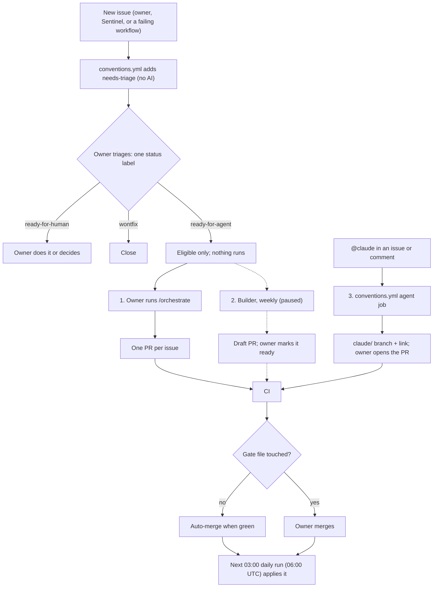

# Labels

The repo keeps **16 labels** (owner decision, 2026-10-13; the four priority labels
returned the same day). Do not create a label outside this set. Before that date
there were 39, from six sources, and only five had a written meaning.

## Issue labels (11)

Each open issue has **exactly one status** label. A `ready-for-agent` issue also has
**one priority** label. The type labels are optional.

| Label             | Kind   | Meaning                                                        | Does it start work?                                    |
| ----------------- | ------ | -------------------------------------------------------------- | ------------------------------------------------------ |
| `needs-triage`    | status | New. The owner has not decided yet. `conventions.yml` adds it. | No                                                     |
| `ready-for-agent` | status | Fully specified. An agent may take it.                         | No. An agent takes it only when one is started (below) |
| `ready-for-human` | status | The owner must do it, or decide something first.               | No                                                     |
| `wontfix`         | status | Will not be done. Close the issue.                             | No                                                     |
| `bug`             | type   | Something is wrong, including wrong data.                      | No                                                     |
| `tech-debt`       | type   | A cleanup with no new feature.                                 | No                                                     |
| `epic`            | type   | A parent issue that lists child tickets (a map).               | No                                                     |
| `P0-critical`     | priority | Do first: data loss, a broken pipeline or a blocked agent.   | No                                                     |
| `P1-next`         | priority | Do next.                                                     | No                                                     |
| `P2-later`        | priority | Do after P1.                                                 | No                                                     |
| `P3-parked`       | priority | Not planned now. Agents skip it; revisit or close.           | No                                                     |

**Order of work.** An agent takes `ready-for-agent` issues by priority: `P0-critical`,
then `P1-next`, then `P2-later`, then issues with no priority. Within one priority it
takes the oldest first. It never takes `P3-parked`. The owner sets the priority.

A question for the reporter goes in a comment, and the issue keeps `needs-triage`.
A child ticket links to its `epic` with `Part of #<n>`. The tech-debt phase is the
`[A]`..`[D]` title prefix and a `Phase:` line in the body, not a label. Close a
duplicate or an invalid issue with GitHub's close reason ("duplicate", "not planned").

## Origin labels (5), applied by machines

| Label                                                                  | Applied by                                                           |
| ---------------------------------------------------------------------- | -------------------------------------------------------------------- |
| `dependencies`                                                         | Dependabot (`.github/dependabot.yml` sets it on every update)        |
| `agent:orchestrator`, `agent:builder`, `agent:scout`, `agent:sentinel` | the agent that opened the PR, or the issue for the Sentinel (provenance, `docs/planning/AGENTS.md`) |

## What starts work

No label starts work. A label only marks an issue. Work starts in one of three ways:

1. The owner runs `/orchestrate` in a Claude Code session. It takes the open
   `ready-for-agent` issues and opens one PR per issue.
2. The Builder agent runs weekly and takes the oldest `ready-for-agent` issue. It is
   paused (`docs/planning/AGENTS.md`).
3. A user with write access writes `@claude` in an issue, a comment or a review.
   `conventions.yml` starts an agent that pushes a `claude/` branch and posts a link.
   The owner opens the PR. This route works on any issue, whatever its label.

A merge changes nothing in the database or on the site. The analytical SQL and the
dashboard go live on the next daily run.

## For skills

The vendored skills (mattpocock/skills) speak of five triage roles. Map them as
follows: `needs-triage`, `ready-for-agent`, `ready-for-human` and `wontfix` are the
labels of the same name. The `needs-info` role has no label: ask in a comment and
keep `needs-triage`.

The workflow calls the shared workflows in `PedroDnT/agent-triage-conventions` at tag
`v1`. The `@claude` agent needs the Claude GitHub app on this repo and the
`CLAUDE_CODE_OAUTH_TOKEN` repo secret.

GitHub rejects a label that does not exist. Check the list with
`gh api repos/PedroDnT/SILO-BZ/labels`.
