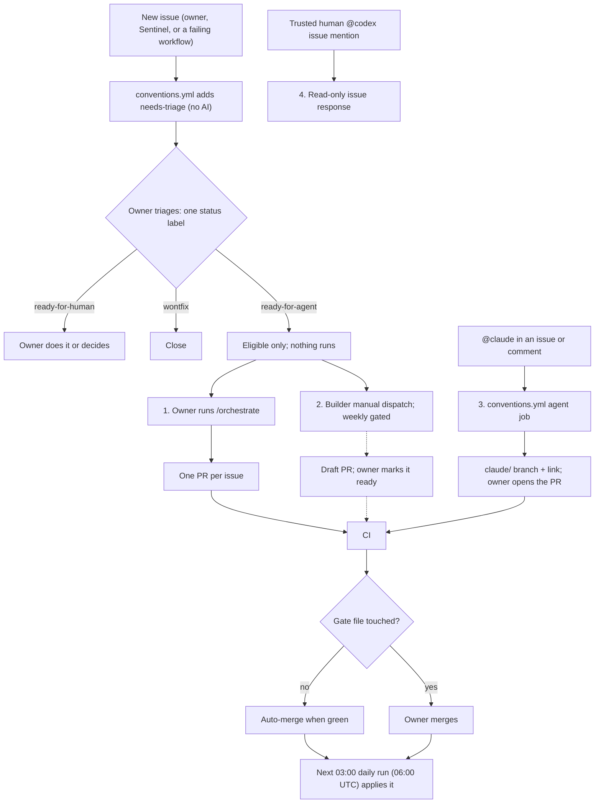

# Labels

The repo keeps **16 labels** (owner decision, 2026-10-13; the four priority labels
returned the same day). Do not create a label outside this set. Before that date
there were 39, from six sources, and only five had a written meaning.

## Issue labels (11)

Each open issue has **exactly one status** label. A `ready-for-agent` issue also has
**one priority** label. The type labels are optional.

| Label             | Kind   | Meaning                                                        | Does it start work?                                    |
| ----------------- | ------ | -------------------------------------------------------------- | ------------------------------------------------------ |
| `needs-triage`    | status | New. The owner has not decided yet. `conventions.yml` adds it. | No                                                     |
| `ready-for-agent` | status | Fully specified. An agent may take it.                         | No. An agent takes it only when one is started (below) |
| `ready-for-human` | status | The owner must do it, or decide something first.               | No                                                     |
| `wontfix`         | status | Will not be done. Close the issue.                             | No                                                     |
| `bug`             | type   | Something is wrong, including wrong data.                      | No                                                     |
| `tech-debt`       | type   | A cleanup with no new feature.                                 | No                                                     |
| `epic`            | type   | A parent issue that lists child tickets (a map).               | No                                                     |
| `P0-critical`     | priority | Do first: data loss, a broken pipeline or a blocked agent.   | No                                                     |
| `P1-next`         | priority | Do next.                                                     | No                                                     |
| `P2-later`        | priority | Do after P1.                                                 | No                                                     |
| `P3-parked`       | priority | Not planned now. Agents skip it; revisit or close.           | No                                                     |

**Order of work.** An agent takes `ready-for-agent` issues by priority: `P0-critical`,
then `P1-next`, then `P2-later`, then issues with no priority. Within one priority it
takes the oldest first. It never takes `P3-parked`. The owner sets the priority.

A question for the reporter goes in a comment, and the issue keeps `needs-triage`.
A child ticket links to its `epic` with `Part of #<n>`. The tech-debt phase is the
`[A]`..`[D]` title prefix and a `Phase:` line in the body, not a label. Close a
duplicate or an invalid issue with GitHub's close reason ("duplicate", "not planned").

## Origin labels (5), applied by machines

| Label                                                                  | Applied by                                                           |
| ---------------------------------------------------------------------- | -------------------------------------------------------------------- |
| `dependencies`                                                         | Dependabot (`.github/dependabot.yml` sets it on every update)        |
| `agent:orchestrator`, `agent:builder`, `agent:scout`, `agent:sentinel` | the agent that opened the PR, or the issue for the Sentinel (provenance, `docs/planning/AGENTS.md`) |

## What starts work

No label starts work. A label only marks an issue. Work starts in these ways:

1. The owner runs `/orchestrate` in a Claude Code session. It takes the open
   `ready-for-agent` issues and opens one PR per issue.
2. Builder takes one eligible issue by priority, oldest within a priority. The
   legacy Claude routine is paused. The Codex workflow supports manual dispatch;
   its weekly schedule stays gated pending validation (#1079).
3. A user with write access writes `@claude` in an issue, a comment or a review.
   `conventions.yml` starts an agent that pushes a `claude/` branch and posts a link.
   The owner opens the PR. This route works on any issue, whatever its label.
4. A human with current repository write access mentions `@codex` in a new issue
   or issue comment. `codex.yml` posts a read-only response using the issue and
   its comments. Ordinary replies and bot comments do not invoke it. This local
   extension leaves native Codex PR mentions to the native integration.

Codex uses the existing `OPENAI_API_KEY` Actions secret and API billing. Model
execution has read-only GitHub permissions and no GitHub write credentials; a
separate publishing job posts responses or validates a Builder patch and opens
one draft PR. Builder stays within the existing dataset/API-only scope.

Actions → **Codex issue responder and Builder** → **Run workflow** defaults to
`dry_run=true`: show eligibility without claiming or calling a model. A dispatch
with `dry_run=false` claims one issue. The Wednesday 10:00 UTC-3 (13:00 UTC)
schedule requires `CODEX_BUILDER_ENABLED=true`; leave it unset until #1079's
manual trial succeeds. Keep the legacy Builder paused to avoid duplicate workers.

Builder and `/orchestrate` use `scripts/agent_queue.py`. GitHub claims remain
cooperative across providers; Codex serializes its own workflow runs and rechecks
the latest claim before publishing. A competing claim blocks publication. An
existing Builder PR blocks new Builder work until reviewed or repaired; the
three-open-agent-PR budget still applies. Tickets: #1077 (responder), #1078
(queue), #1079 (live validation and activation).

A merge changes nothing in the database or on the site. The analytical SQL and the
dashboard go live on the next daily run.

## For skills

The vendored skills (mattpocock/skills) speak of five triage roles. Map them as
follows: `needs-triage`, `ready-for-agent`, `ready-for-human` and `wontfix` are the
labels of the same name. The `needs-info` role has no label: ask in a comment and
keep `needs-triage`.

The workflow calls the shared workflows in `PedroDnT/agent-triage-conventions` at tag
`v1`. The `@claude` agent needs the Claude GitHub app on this repo and the
`CLAUDE_CODE_OAUTH_TOKEN` repo secret.

GitHub rejects a label that does not exist. Check the list with
`gh api repos/PedroDnT/SILO-BZ/labels`.
